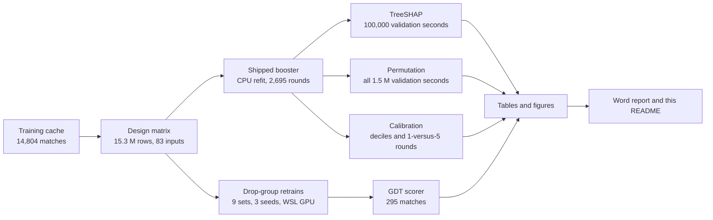
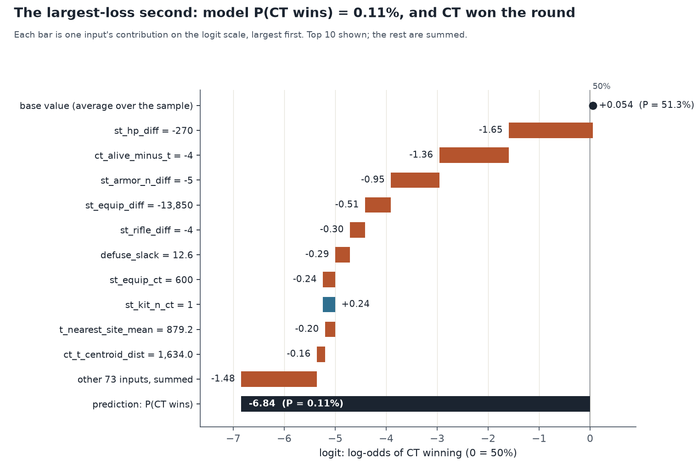
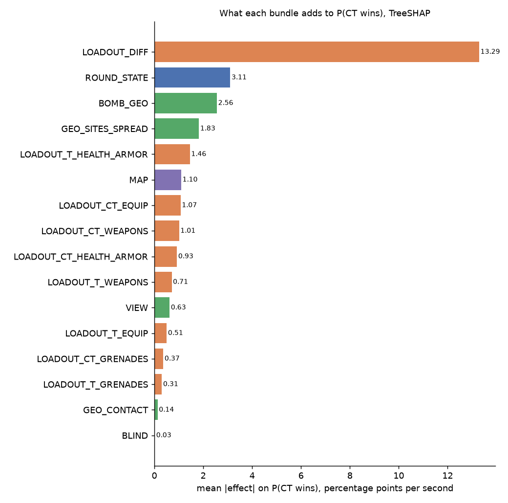
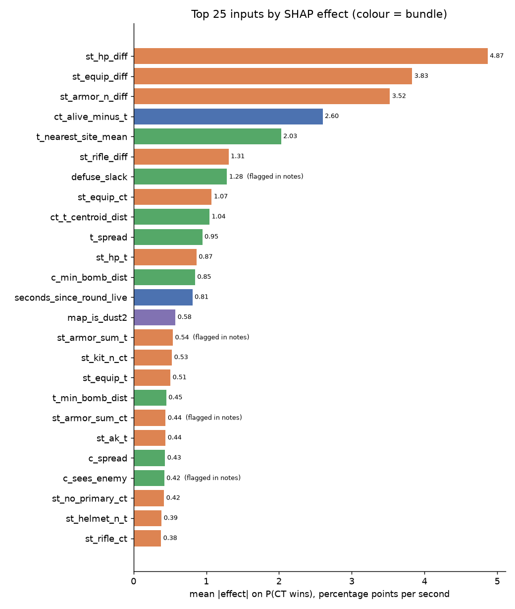
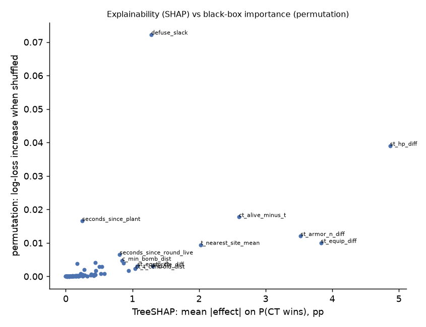
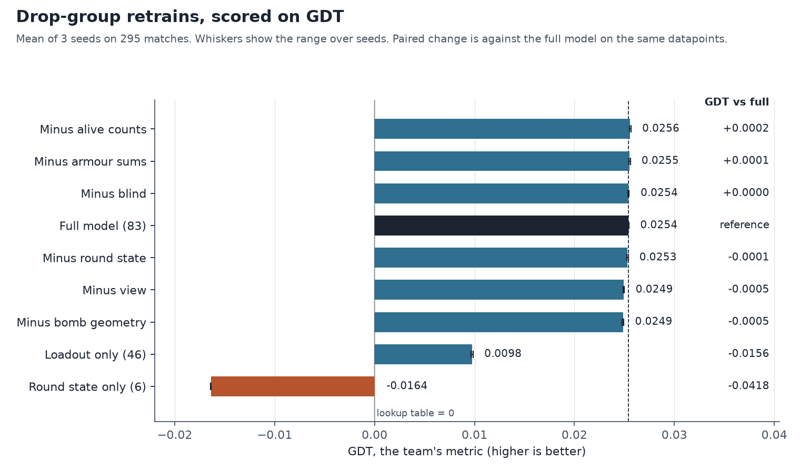
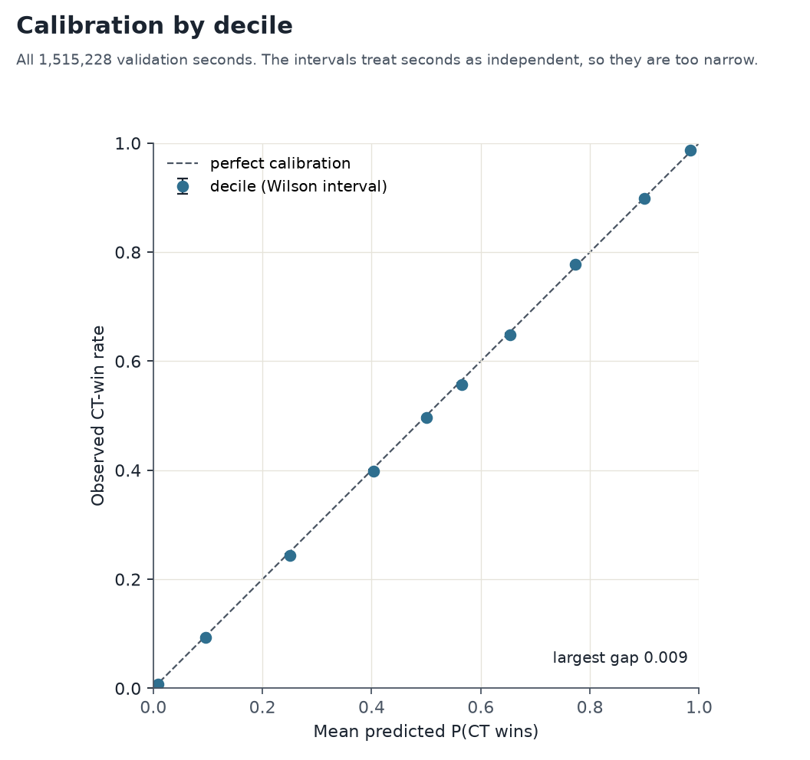

# Explainability for the 83-input win-probability model

As of Nov 6, 2026. This folder explains the 83-input XGBoost model that gives the probability that CT wins a CS2 round, second by second. It answers three questions:

1. **Which inputs matter, and how much?** A global view by bundle of inputs, and drop-group retrains.
2. **Where did one prediction come from?** A local view: what each input contributed to one second.
3. **How do two predictions differ, and which inputs work together?** Contrasts and interactions.

> **In short.** The loadout inputs (each side's equipment, armour and health) carry most of the signal. Among the single-group drops tested, none costs more than 0.0005 GDT, the team's metric. Round state, position and map together add about 0.016 GDT on top of loadout alone. Calibration holds per decile (largest gap 0.009) and in the 1-versus-5 state, checked per round.

Explanation and importance are reported separately:

- *Explanation* (TreeSHAP) says where each prediction came from. Each input's contribution adds up exactly to the prediction.
- *Importance* (permutation) is black-box. It says how much the model's log loss rises when one input is shuffled.

The team's evaluation metric is **GDT**, the gain over the lookup table (see [the scorer's README](../../evaluation/intern_gdt/README.md)). Log loss is reported alongside it.

## Contents

- [At a glance](#at-a-glance)
- [Status](#status)
- [Where to look](#where-to-look)
- [One prediction: four example seconds](#one-prediction-four-example-seconds)
- [Two predictions: contrasts](#two-predictions-contrasts)
- [Interactions](#interactions)
- [Global results](#global-results)
- [Drop-group ablations, scored on GDT](#drop-group-ablations-scored-on-gdt)
- [Calibration](#calibration)
- [Model and data](#model-and-data)
- [Caveats](#caveats)
- [Reproduce](#reproduce)
- [Files](#files)

## At a glance

| Question | Answer | Go to |
|---|---|---|
| Which inputs matter most? | The loadout difference (CT minus T) averages 13.3 pp of effect per second. The 24 position inputs total 3.5 pp. | [Global results](#global-results) |
| How does it score on the team's metric? | GDT 0.0254 on 295 matches (scorer interval 0.0217 to 0.0290). Loadout alone scores 0.0098. | [GDT ablations](#drop-group-ablations-scored-on-gdt) |
| Is it calibrated? | Largest decile gap 0.009 over 1,515,228 validation seconds. In 1,033 rounds in 1-versus-5 states: 1.48 CT wins expected, 1 observed. | [Calibration](#calibration) |
| What is still open? | Rebuilding the matrix from raw data, the Oct 9–10 match counts, and the feature fixes from the team notes. | [Caveats](#caveats), [handover](../../handover/explainability/README.md) |

### How the pieces fit

## Status

| Item | Status | Where |
|---|---|---|
| Global effects by bundle and by input | Done | [tables](tables/), [bundle figure](figures/bundle_effects.png) |
| One prediction (waterfalls, four seconds) | Done | [local/](local/), [examples](local/examples.csv) |
| Contrasts between two predictions | Done | [local/](local/) |
| Interactions (2,000 seconds) | Done | [top pairs](local/interactions_top_pairs.csv) |
| Drop-group retrains, scored on GDT | Done, 9 sets × 3 seeds | [section](#drop-group-ablations-scored-on-gdt) |
| Calibration per second and per round | Done | [section](#calibration) |
| Rebuilding the design matrix from raw tomes | **Not verified** | [handover item 1](../../handover/explainability/README.md#open-items) |
| Oct 9–10 match counts | **Open**, sources disagree | [caveats](#caveats) |
| Deep model | Handoff only, no training run | [handover/deep-model](../../handover/deep-model/README.md) |

## Where to look

| You want | Go to |
|---|---|
| The write-up with figures (10 pages) | [XGB_explainability_report.docx](XGB_explainability_report.docx) |
| The shipped model and its metadata | [winprob_xgb83_final.json](../../models/winprob_xgb83_final.json), [meta](../../models/winprob_xgb83_final.meta.json) |
| Global results by bundle | [bundle_importance_and_effects.csv](tables/bundle_importance_and_effects.csv) |
| Each input: effect, slope, curve | [feature_slopes_all83.csv](tables/feature_slopes_all83.csv), [feature_curves_all83.csv](tables/feature_curves_all83.csv) |
| One prediction, a contrast, interactions | [local/](local/) |
| The 57-input submission model, on the same seconds | [xgb57/tables/](xgb57/tables/) |
| GDT for the ablations | [drop_ablation_83_gdt.csv](tables/drop_ablation_83_gdt.csv) |
| How to rerun everything | [Reproduce](#reproduce), and the [handover](../../handover/explainability/README.md) |

## One prediction: four example seconds

Four seconds from the 100,000-second validation sample were chosen by fixed rules. The rules are recorded in [local_explain_meta.json](local/local_explain_meta.json), and the match keys are in [examples.csv](local/examples.csv).

| Example | Match (date), round, second | Label | P(CT wins) | Why it was chosen | Waterfall |
|---|---|---|---|---|---|
| `largest_loss` | m_d6966528… (Oct 9), round 2, second 52 | CT wins | 0.11% | Largest log loss in the sample: a 1-versus-5 clutch the model gave almost no chance | [csv](local/waterfall_largest_loss.csv) |
| `confident_ct_win` | m_8bf2efa1… (Oct 8), round 23, second 100 | CT wins | 99.999% | The most confident correct call for CT | [csv](local/waterfall_confident_ct_win.csv) |
| `confident_t_win` | m_543d3085… (Oct 13), round 2, second 71 | T wins | 0.00002% | The most confident correct call for T | [csv](local/waterfall_confident_t_win.csv) |
| `close_call` | m_eb0c3614… (Oct 12), round 18, second 49 | T wins | 50.0% | The second closest to a coin toss | [csv](local/waterfall_close_call.csv) |

**Reading a waterfall.** The base value is the model's average logit, P = 51.3%. Each input adds a contribution on the logit scale, largest first. The base plus the contributions equals the prediction's logit exactly, checked to 0.001. The `pp_leave_out` column is the change in probability if that one contribution is removed. Those changes do not add up, because the sigmoid is not linear.

For the `largest_loss` second, the biggest pushes against CT were:

- team HP difference of −270 (CT has 100 HP, T has 370), about the 1st percentile of the sample: −1.65 logit;
- CT alive minus T alive of −4 (1 against 5), about the 1st percentile: −1.36 logit;
- armoured-player difference of −5: −0.95 logit;
- equipment difference of −$13,850: −0.51 logit.

## Two predictions: contrasts

[contrast_confident_ct_vs_t.csv](local/contrast_confident_ct_vs_t.csv) compares the two confident calls (P = 99.999% against P = 0.00002%). The logit gap is 27.1, and the per-input differences add up to it exactly. The largest contributors:

| Input | CT-call value | T-call value | Difference in logit |
|---|---|---|---|
| defuse slack (seconds) | 24.1 | −20.4 | +4.59 |
| team HP difference | +393 | −326 | +2.95 |
| CT alive minus T alive | +4 | −4 | +2.72 |
| CT distance to nearest bomb spot | 6.5 | 2,431 | +2.05 |
| armoured-player difference | +4 | −5 | +1.94 |
| seconds since plant | 10.2 | 40.7 | +1.85 |

[contrast_largest_loss_vs_neighbour.csv](local/contrast_largest_loss_vs_neighbour.csv) compares the `largest_loss` second with its nearest neighbour, which must have the same alive counts and bomb state. Distance is measured on the top 10 inputs. The neighbour's prediction is almost the same (0.11% against 0.11%), so the model treats those seconds alike. This contrast is more useful as a calibration check than as an explanation.

## Interactions

[interactions_top_pairs.csv](local/interactions_top_pairs.csv) lists the strongest input pairs by mean absolute SHAP interaction value, computed on 2,000 of the sample seconds. The row sums match the SHAP values to 9e-6.

- The largest pair is seconds since plant with defuse slack (0.039 logit). Both are about the bomb timeline.
- Next are team HP difference with armoured-player difference (0.034), and alive difference with armoured-player difference (0.033).

These are small compared with the main effects. The inputs in these pairs contribute 0.06 to 0.48 logit each on average, and the interaction values are 0.03 to 0.04. The file reports xgboost's off-diagonal entry. The standard total pair effect is twice that value.

## Global results

Average absolute effect on P(CT wins), in percentage points per second, from TreeSHAP on 100,000 validation seconds ([full table](tables/bundle_importance_and_effects.csv)):

| Bundle | Inputs | Average effect (pp) |
|---|---|---|
| Loadout difference, CT minus T | 6 | 13.29 |
| Round state | 6 | 3.11 |
| Bomb distance and defuse slack | 4 | 2.56 |
| Site and spread geometry | 9 | 1.83 |
| T health and armour | 6 | 1.46 |
| Map | 7 | 1.10 |

Position (24 inputs) totals 3.50 pp, visibility (4 inputs) 0.63 pp, and blindness (4 inputs) 0.03 pp.

The 25 inputs with the largest effects are below. Colour shows the bundle: orange for loadout, green for position, blue for round state, purple for map. Four were flagged in the team's notes.

The SHAP ranking and the permutation ranking disagree for a few inputs, and the figure below shows where:

The 57-input submission model (no position inputs) gives round state 4.72 pp, against 3.11 pp. Its bomb-timing inputs take over what defuse slack and bomb distance carried. Validation log loss is 0.453557 for 57 inputs, against 0.450210 for 83. Comparison: [compare_83_vs_57_bundles.csv](xgb57/tables/compare_83_vs_57_bundles.csv).

## Drop-group ablations, scored on GDT

Each set is the full 83-input model with one group removed, or one group alone. Same matrix, split and fit settings as the sprint's full cell. Three seeds each, refit in one environment: xgboost 3.2.0 on the WSL RTX 3080.

GDT is the team's metric, from [score_gdt.py](../../evaluation/intern_gdt/score_gdt.py), on the 295-match population: matches dated Sept 1 to Oct 8, with rounds that start 5 against 5. Paired differences are against the full model with the same seed, on the same datapoints. Negative means worse.

| Set (inputs) | GDT, mean of 3 seeds | Paired GDT vs full (range over seeds) | Log loss, all validation seconds | Paired log loss vs full |
|---|---|---|---|---|
| full (83) | 0.0254 | reference | 0.450270 | reference |
| minus alive counts (80) | 0.0256 | +0.0002 (+0.0000 to +0.0003) | 0.450536 | +0.00027 |
| minus armour sums (81) | 0.0255 | +0.0001 (−0.0000 to +0.0004) | 0.450259 | −0.00001 |
| minus blind (79) | 0.0254 | +0.0000 (−0.0001 to +0.0002) | 0.450255 | −0.00002 |
| minus round state (77) | 0.0253 | −0.0001 (−0.0002 to +0.0001) | 0.451096 | +0.00083 |
| minus view (79) | 0.0249 | −0.0005 (−0.0006 to −0.0004) | 0.450552 | +0.00028 |
| minus bomb geometry (79) | 0.0249 | −0.0005 (−0.0007 to −0.0004) | 0.450614 | +0.00034 |
| loadout only (46) | 0.0098 | −0.0156 (−0.0158 to −0.0154) | 0.463166 | +0.01290 |
| round state only (6) | −0.0164 | −0.0418 (−0.0418 to −0.0416) | 0.497067 | +0.04680 |

What the table says:

- **Alive counts.** Removing them does not reduce GDT, so the loadout inputs carry the alive signal.
- **Round state.** Removing it from the full model costs nothing on GDT. Alone, it scores below the lookup table.
- **Loadout only** beats the table (GDT 0.0098). Round state, position and map together add about 0.016 GDT on top of it.
- **Armour sums and blind.** No measurable effect on GDT. The team's notes asked to drop the armour sums and to rebuild the blind inputs.
- **View and bomb geometry.** Each gives a small, consistent gain of about 0.0005 GDT. For each, the paired interval excludes zero in two seeds and touches it in the third.

The full model's scorer numbers match the team's documented 83-input figure: GDT 0.0254, for the 297-match population in [TRAINING_METRIC.md](../final/TRAINING_METRIC.md). This population is 295 matches. The full model's log loss matches the sprint's saved values on each seed to within 0.00005 ([reproduction table](tables/drop_ablation_reproduction.csv)).

Tables: [drop_ablation_83_gdt.csv](tables/drop_ablation_83_gdt.csv), [drop_ablation_83.csv](tables/drop_ablation_83.csv), [drop_ablation_83_per_seed.csv](tables/drop_ablation_83_per_seed.csv), and the scorer summaries [seed 0](tables/gdt_ablation_summary_seed0.json), [seed 1](tables/gdt_ablation_summary_seed1.json), [seed 2](tables/gdt_ablation_summary_seed2.json).

## Calibration

**Overall.** Deciles of predicted probability over all 1,515,228 validation seconds match the observed CT-win rate to within 1 percentage point in every decile ([calibration_deciles_shipped.csv](tables/calibration_deciles_shipped.csv)). The intervals in that table treat seconds as independent, so they are too narrow.

**The largest miss's state (1 CT alive against 5 T).** Seconds in a round share one outcome, so this is checked per round, using the sum of each round's mean predicted probability ([calibration_1v5_shipped.csv](tables/calibration_1v5_shipped.csv)):

| State | Rounds | Expected CT-win rounds | Observed CT-win rounds |
|---|---|---|---|
| any bomb state | 1,033 | 1.48 | 1 |
| bomb planted | 580 | 0.59 | 1 |
| no bomb | 724 | 1.30 | 0 |

The one win is the largest miss's own round. The earlier "3 wins in 426 seconds" was that same round, counted per second. So this data does not show a calibration problem in this state.

## Model and data

- **Model.** XGBoost, binary logistic, 83 inputs: 59 base, plus GEO (16), VIEW (4) and BLIND (4). Depth 4, eta 0.03, min_child_weight 20, subsample 0.8, max_bin 256, seed 0. Early stopping after 100 rounds on a 10% split, with a 3,000-round cap. Best iteration 2,695 (the sprint's was 2,555). Monotone constraints on the alive counts.
- **The shipped file** is [winprob_xgb83_final.json](../../models/winprob_xgb83_final.json). It is a CPU refit, and it is byte-identical to the booster these explanations were computed from. Its metadata records the checklist deviation: the armour sums and the sees-enemy and exposed inputs are kept.
- **Training pool.** `cache_snapshot_2026.parquet`: 14,804 matches dated 2026-08-02 to 2026-10-13. The validation sample has 1,168 matches and 1,515,228 seconds. Checked Nov 5, 2026: the pool has no match on or after Oct 26, and no match in common with the Oct 26–31 holdout keys.
- **Fit.** The CPU refit gives validation log loss 0.450210. The sprint's GPU run gave 0.450228. Per-row predictions differ from the sprint's by up to 0.25 (mean 0.004), so the refit is not identical to the GPU run.
- **Protocol.** The team's rules are in [MODELS_TO_RUN.md](../final/MODELS_TO_RUN.md). Nothing here reads the frozen test or the Oct 26–31 holdout.

## Caveats

- **Oct 9 and Oct 10.** The [handoff of Nov 4](../handoff/2026-11-04_tomes_to_model.md) marks these days as unreconciled and gives 2,598 matches for them. The training cache holds 4,865 matches dated Oct 9–10 (2,214 and 2,651). The two counts disagree, so reconcile them before relying on those days. The `largest_loss` example is from Oct 9.
- **Missing and sentinel values.** `defuse_slack` is missing when no bomb is planted, and `seconds_since_plant` is −1. Both inflate permutation importance.
- **Correlated inputs.** TreeSHAP splits credit between correlated inputs. The alive counts get little direct credit, and the retrains show why: dropping them costs nothing on GDT.
- **Not causal.** These explain the model's behaviour. They are not causal effects.
- **Clustered outcomes.** Seconds in a round share one outcome, so per-second statistics overstate the evidence. The 1-versus-5 check is therefore done per round.
- **GDT population.** 295 matches here, against 297 in the team's notes. The full model still reproduces the team's GDT.
- **Small samples.** The interaction values use 2,000 seconds.

## Reproduce

Environments:

- **Windows (pixi):** `G:\pureskill\csds-cs2\.pixi\envs\default\python.exe`. It has xgboost (CPU build), polars, numpy and matplotlib.
- **WSL Ubuntu, GPU:** Python 3.10 with `xgboost` 3.2.0 (CUDA). Install with `python3 -m pip install --user xgboost numpy`. The ablation runs need the matrix copied to WSL's own disk first (the script memory-maps it).

The data is not in git. Where each input lives is listed in the [handover](../../handover/explainability/README.md#inputs-not-in-git).

1. **Design matrix** (5.1 GB, not in git). Written by [sprint_prepare.py](../../experiments/sprint/sprint_prepare.py) from the training cache, the position table `cache_pos_2026_trainctr.parquet`, and `frozen_test_keys.json`. It excludes the holdout-B keys. **Not rerun**, and `frozen_test_keys.json` was not found. The existing matrix is from Nov 3, 2026.
2. **Explanation pipeline**, run in order. Set `CS2_EXPLAIN_MATRIX` and `CS2_EXPLAIN_WORK` if the matrix and work folder are not at their defaults.
   - `python scripts/explain/xgb83_explain.py --stage train` (refits on CPU, about 83 minutes)
   - `python scripts/explain/xgb83_explain.py --stage explain`
   - `python scripts/explain/xgb83_explain.py --stage report`
   - `python scripts/explain/feature_curves.py`, then `python scripts/explain/feature_curve_figs.py`
   - `python scripts/explain/xgb83_local.py` (about 5 seconds, after `explain`)
   - `python scripts/explain/xgb57_explain.py`
   - `python scripts/explain/xgb83_calibration.py`
3. **Drop-group ablations** (WSL, GPU; about 40 minutes):
   - `python3 scripts/explain/xgb83_drop_ablation.py --matrix /home/<user>/sprint/matrix_trainctr --out /mnt/c/Users/<user>/sprint/explain83_ablation --device cuda`
4. **GDT and tables** (Windows):
   - `python scripts/explain/xgb83_gdt.py --sets full minus_alive round_state_only loadout_only minus_round_state minus_blind minus_view minus_armor_sums minus_bomb_geo --seeds 0 1 2`
   - `python scripts/explain/xgb83_ablation_report.py`
5. **Word report.** [prep_docx_data.py](../../scripts/explain/docx/prep_docx_data.py) collects the tables and figures. [build_docx.js](../../scripts/explain/docx/build_docx.js) builds the `.docx` with the `docx` package, and takes the output path as its second argument.
6. **README figures.** `python scripts/explain/readme_figs.py` draws the GDT, calibration and waterfall figures. It reads only the committed tables and [local/](local/), so it runs without the data.

## Files

| Path | What it is |
|---|---|
| [README.md](README.md) | This file, for people |
| [README.agents.md](README.agents.md) | The same results, with the file map and invariants that agents need |
| [XGB_explainability_report.docx](XGB_explainability_report.docx) | The 10-page Word report |
| [tables/](tables/) | Global tables, calibration tables, and the GDT ablation tables |
| [figures/](figures/) | PNG figures for this README and the report |
| [local/](local/) | One-prediction waterfalls, contrasts, interactions, and their metadata |
| [xgb57/tables/](xgb57/tables/) | The 57-input model's effects, permutation scores, and comparison |

The scripts are in [scripts/explain/](../../scripts/explain/), including [readme_figs.py](../../scripts/explain/readme_figs.py). The handover notes are in [handover/explainability/](../../handover/explainability/README.md).
